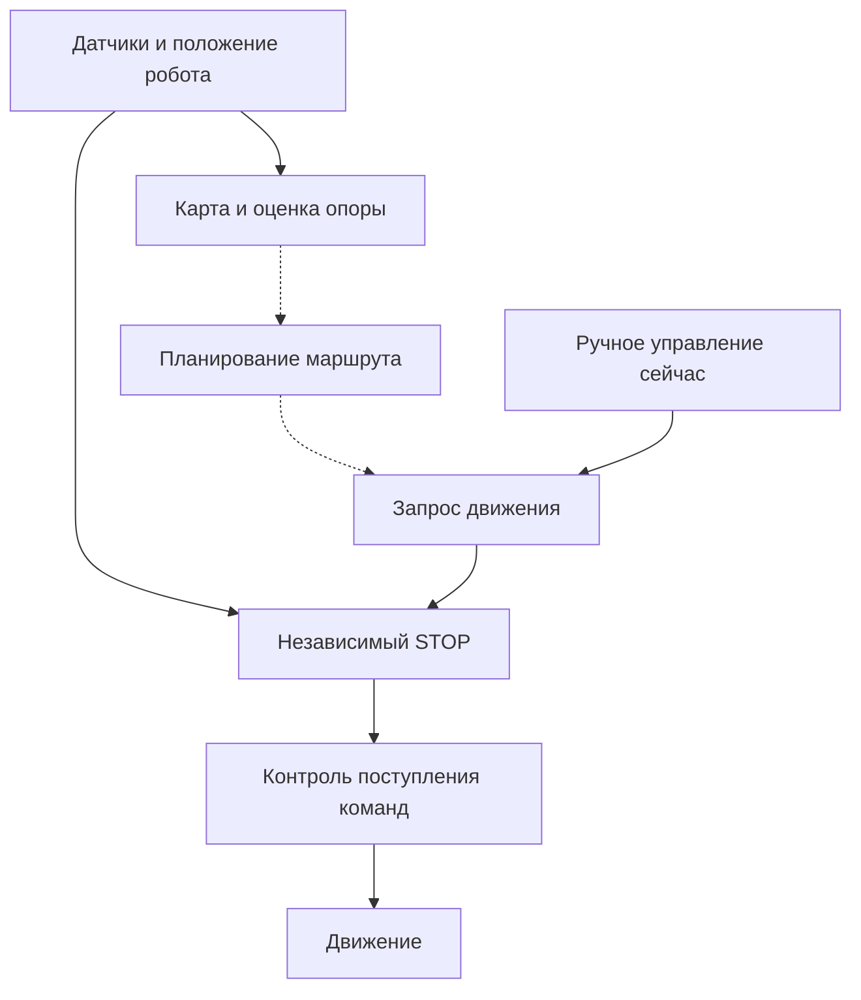

# Зачем нужны этапы GuideDog-Go2

Состояние на 6 ноября 2026. Подробная [карта развития](project-roadmap-ru.md)
связывает этапы с результатами и исследованиями; здесь объяснены их зависимости.
[Следующая сессия](next-session.md) начинается с напоминания о раннем STOP.

Цель — функциональный прототип в симуляции: робот достигает цели, учитывает
сопровождаемого человека и проходит заданные лестницы вверх и вниз.
Аппаратные испытания Go2 Air и испытания с людьми — отдельные этапы.

Пунктир — будущая связь с планировщиком. Сейчас карта не управляет роботом;
независимый STOP проверяет исходный LiDAR, время и доступность нужных TF.

| Этап | Зачем | Что получает следующий этап |
| --- | --- | --- |
| Окружение, Git и точки возврата | Повторять опыт и восстанавливать рабочее состояние | Проверяемую основу для изменений |
| Диагностика данных, времени и нагрузки | Различать пропажу измерений, задержки и ошибки алгоритма | Свежие данные с известными ограничениями |
| Координаты и положение датчиков | Связать облако с корпусом и окружающей сценой | Препятствия в правильных местах |
| Движение и одометрия | Сравнить фактический путь и оценку перемещения | Карту, сохраняющую положение объектов при движении |
| STOP и watchdog | Ограничить прямое движение перед коробкой и при потере данных/команд | Отдельный контроль выходных команд для следующих опытов |
| Локальная карта | Хранить наблюдаемый пол, препятствия и неизвестные участки | Пространственную основу для выбора пути |
| Фильтр корпуса и дальности | Исключить собственные детали и насыщенные измерения из подтверждений пола | Более обоснованные ближние наблюдения |
| Оценка опоры | Различать достаточные свидетельства пола и недостаток данных | Условия, при которых путь можно считать допустимым |
| Планирование и предварительный просмотр | Построить путь или объяснить отсутствие прохода | Маршрут для последующей проверки движения |
| Повороты и выполнение пути | Учитывать пространство всего тела, движение и отсутствие прогресса | Ограниченный сценарий объезда к цели |
| Зрение | Различать людей и классы объектов и связывать их с геометрией | Семантические сведения для поведения и сопровождения |
| Рельеф и лестницы | Оценивать края, переходы высот и геометрию ступеней | Условия подхода, остановки и отдельной проверки прохода |
| Виртуальный человек | Проверять общий проход, темп, ожидание и коммуникацию | Полный симуляционный сценарий сопровождения |
| Go2 Air | Проверять реальные интерфейсы, измерения, движение и потери связи | Аппаратные результаты, отдельные от симуляционных |
| Люди | Проверять взаимодействие, ручку, сообщения и темп с профильными специалистами | Данные отдельных испытаний сопровождения |

Проверенная часть сейчас включает 130 тестов, STOP с работающей картой,
короткую карту, один новый проезд 2,003 м и неподвижные проверки фильтра,
проёма и отказов данных. Это не завершение всех вех: планировщик, повороты,
рельеф, сопровождение и аппаратный перенос ещё не подключены.

Почему порядок важен: в раннем заезде робот фактически прошёл около 2 м,
а одометрия насчитала около 1,1 м. Препятствия оказывались не на своих местах
на карте; поэтому сначала потребовались устойчивое движение и калибровка odom.
В другом типе ошибки собственная лапа могла попадать в полосу плоскости пола;
геометрический фильтр и запрет исключённой клетки предотвращают такое
положительное свидетельство. Отсутствие точек может означать проём, затенение
или потерю данных — оно остаётся неизвестным.

## Порядок ближайшей работы

1. Показать расстояние, порог и причину остановки. Измерениями проверить
   практичный зазор с учётом слепой зоны LiDAR, задержек и отказов данных.
2. Обосновать контакты лап, видимость и промежутки между лучами. Контакт в
   четырёх точках не доказывает пол между лапами или проход для человека.
3. Проверить связный допустимый проход и показывать планируемый маршрут.
4. Проверить повороты и расширенную защиту, затем выполнить объезд к цели.
5. После профилирования ресурсов развивать зрение параллельно геометрии.
6. Расширить геометрию на рельеф и ступени, отдельно проверить движение
   и устойчивую остановку на лестницах вверх и вниз.
7. Объединить это с виртуальным человеком и проверить симуляционный MVP.

Доступность интерфейсов конкретной версии Air следует выяснять заранее,
параллельно работе, чтобы не строить адаптер на неподтверждённых предположениях.
Физический перенос затем проходит собственную последовательность испытаний.

Тесты и отчёты сопровождают каждый шаг. Они фиксируют улучшения, отказы и
сохранение прежних возможностей; число тестов относится к проверенным условиям.
