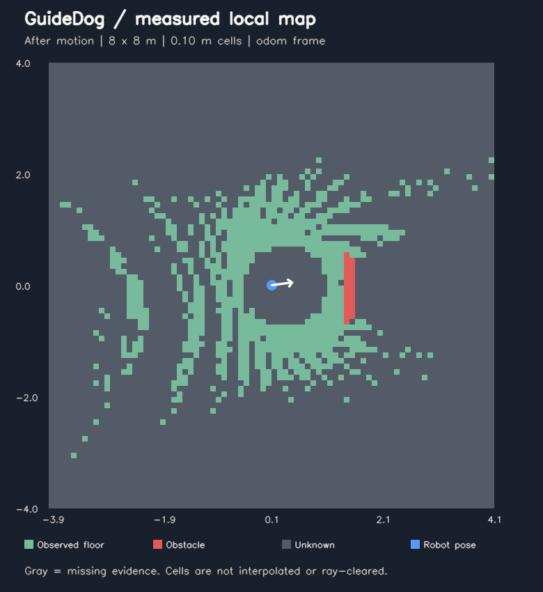

# Локальная карта: проверка в Gazebo

5 ноября 2026 · Ubuntu 24.04.5 ARM64 / UTM · ROS 2 Jazzy · Gazebo Sim 8.15.

Реализован первый вариант локальной карты для ровной сцены: **свободно,
занято, неизвестно**, возраст наблюдений, индикатор накопленных подтверждений
и наблюдаемая высота/разброс точек пола. Карта пока не управляет движением.
Независимая защита по исходному LiDAR и watchdog продолжают ограничивать команды.

Основа — `fa7c1dd0882a3df9af658fc066084cd533d3e7a4`, новая ветка — `feat/local-map`.
Внешний симулятор закреплён на `55ff151632a0220bf3ae0c0772392615d86da7a8`.
Полная спецификация сообщений, времени и правил наблюдения — в
[руководстве карты](local-map.md).

## Что получилось



Зелёный — наблюдаемый пол, красный — препятствие, серый — неизвестное.
Синяя точка и белая стрелка — последняя наблюдаемая поза и направление робота.
Изображение построено по сохранённым ячейкам; промежутки не закрашиваются.

| Проверка | Измеренный результат |
| --- | --- |
| Размер / разрешение | 8 × 8 м / 0,10 м, 6400 ячеек |
| Перед коробкой | 11 занятых ячеек; p95 расстояния до эталонной границы 2,1 см |
| Скрытый коробкой пол | Все 18 проверяемых ячеек остались неизвестными |
| Движение робота | 0,103 м по Gazebo ground truth; сетка смещалась целыми ячейками |
| После движения | 24 занятых ячейки около коробки; p95 ошибки границы 9,6 см |
| Короткое отключение LiDAR | Препятствие сохранилось, состояние карты стало несвежим |
| Длительное отключение | Все 6400 ячеек стали неизвестными; исходная метка не обновлялась |
| Возврат данных | Карта снова получила коробку из реальных облаков |
| Удаление коробки | 7 бывших занятых ячеек стали свободными по новым точкам пола |
| Хранение ячеек | 179 200 байт, около 175 КиБ |
| Обработка облака, p95 | 5,21 мс в сценарии карты; 5,95 мс в финальном снимке проверки STOP |
| Столкновения | 0 контактов робота с коробкой |

Допуски были заданы до заезда: p95 ошибки границы ≤20 см, минимум три занятых
ячейки около коробки, минимум 80% неизвестных ячеек в заданной тени коробки,
фактическое продвижение ≥5 см, хранение ячеек ≤1 МиБ, p95 обработки ≤100 мс.
Серия прошла. Эталон Gazebo сопоставляется с odom один раз перед движением;
он не поступает в узел карты. Ошибка границы относится к выбранным занятым
ячейкам около известной коробки, а не ко всем объектам или состояниям робота.

Время обработки включает декодирование облака, преобразования точек, подгонку
плоскости и изменение ячеек. Оно не включает ожидание TF, сериализацию ROS
и отрисовку отчёта. Указанная память — массивы ячеек, не весь процесс Python
и не вся виртуальная машина. Финальные снимки всей VM показывали 81–83% CPU
и около 1,4 ГиБ доступной памяти; это показатели этих окон, не отдельного узла.

## Проверка прежнего STOP с включённой картой

Отдельный полный заезд с дополнительным узлом карты прошёл:

- Свободный путь и боковая коробка — движение разрешалось.
- Передняя коробка — остановка с зазором в измеряемом коридоре **0,816 м**.
- После удаления коробки удерживаемая команда не возобновляла движение.
- Отключение потока LiDAR — наблюдаемый ноль выходной команды через **1,524 с**.
- Потеря команд — наблюдаемый ноль через **0,463 с**.
- Контактов робота с препятствием — **0**. Датчик контакта перед заездом
  проверен падением отдельного пробного объекта на коробку.

Это время по часам наблюдателя при получении сообщений. Оно не является
синхронизированной задержкой от физического датчика до исполнительного механизма.

## Автоматические проверки и найденные ошибки

**63 теста прошли, один ранее отключённый пропущен, ошибок и падений нет.**
Четыре предупреждения относятся к fork внутри средства проверки стиля.

Добавлены 18 проверок сетки и одна интеграционная проверка ROS. Они покрывают
подтверждённый пол, смешанные и редкие точки, низкие/неподдерживаемые высоты,
три последовательных подтверждения очистки, старение без новых данных,
смещения сетки в четырёх направлениях, скачок одометрии, слои высоты и возраста,
позднее подключение подписчика, задержанный/отсутствующий TF, остановку/сброс
часов и повтор старого кадра.

Первый запуск тестов выявил ошибку: повтор кадра, который раньше поступил,
но не завершил обработку TF, мог обновить карту после возобновления часов.
Теперь проверяется максимальная метка **всех полученных кадров** до очереди.
Повторы и кадры не по порядку не обновляют наблюдения. Первоначальные журналы
этого падения сохранены в архиве измерений.

При добавлении проверки отсутствующего TF уточнено ожидание теста: корректный
кадр, уже ожидающий TF, может завершиться после начала подачи некорректных
кадров. Тест проверяет, что метка принятого кадра не превосходит последнюю
корректную метку и что ячейки истекают в неизвестное состояние. Сроки годности
и производственный код ради прохождения этой проверки не менялись.

## Запуск

В Ubuntu:

```bash
source /opt/ros/jazzy/setup.bash
cd ~/guidedog_ws
colcon build --packages-select guidedog_perception --symlink-install
~/guidedog_ws/src/GuideDog-Go2/scripts/run_local_map.sh
```

Во втором терминале:

```bash
~/guidedog_ws/src/GuideDog-Go2/scripts/drive_guarded.sh
```

`i` — вперёд в проверенном профиле 0,05 м/с; `k` или пробел — нейтральная команда.
Изображение находится в `mapping/local_map.svg` внутри напечатанного при запуске
каталога `~/.ros/guidedog/reports/`. Оно обновляется раз в две секунды; при просмотре
обновляй изображение. Рядом — `local_map_report.json` и массивы `local_map.npz`.

Автоматические заезды запускаются последовательно:

```bash
~/guidedog_ws/src/GuideDog-Go2/scripts/test_obstacle_demo.sh --map-benchmark
~/guidedog_ws/src/GuideDog-Go2/scripts/test_obstacle_demo.sh --with-local-map
```

Для Gazebo нужен разблокированный рабочий стол Ubuntu. Во время этой проверки
использовалась временная блокировка автоматического простоя на время процесса;
постоянные настройки экрана не менялись.

## Сохранённые данные

В этом репозитории вместе с кодом сохранены:

- [Сценарии карты](validation/local-map-20261105/benchmark-map.json).
- [Сценарии STOP с включённой картой](validation/local-map-20261105/benchmark-stop-with-map.json).
- [Результат автоматических тестов](validation/local-map-20261105/pytest.xml).
- [Ячейки карты после движения](validation/local-map-20261105/map-after-motion.json).

Полные измерения Ubuntu: `~/.ros/guidedog/reports/local-map1-20261105/` и
`local-map-regression-20261105/`. В них лежат `benchmark.json`, `launch.log`,
снимки `map-*.json` / `map-*.svg`, отчёты датчиков, STOP и карты в `session/`.
В метаданных указан родительский коммит и изменённая рабочая копия на момент
измерений. Финальный коммит и контрольные суммы фиксируются в резервной копии
этапа на Mac: `output/guidedog-local-map-20261105/`.

## Границы результата и следующий шаг

Это первый слой локальной геометрии для ровной сцены. Свободная ячейка означает
наблюдаемые точки пола; она ещё не доказывает проходимость всего корпуса
или сопровождаемого человека. Неизвестные участки не считаются свободными.

Рельеф, отдельные слои наклона/проходимости, ямы, края, лестницы, человек,
планировщик и настоящий Go2 Air этим этапом не проверялись. Индикатор подтверждений
не является калиброванной вероятностью; ошибки одометрии остаются ограничением.
RGB и совместная нагрузка с камерой ещё требуют измерения. Серия — ограниченная
проверка воспроизводимого сценария, не статистическая оценка надёжности.

Следующий рабочий цикл — проверить карту на нескольких препятствиях и более
длинном движении, затем согласовать использование занятых/свободных/неизвестных
ячеек простым локальным планировщиком. Подключение поворотов и объезда потребует
отдельного расширения и проверки защиты движения.
