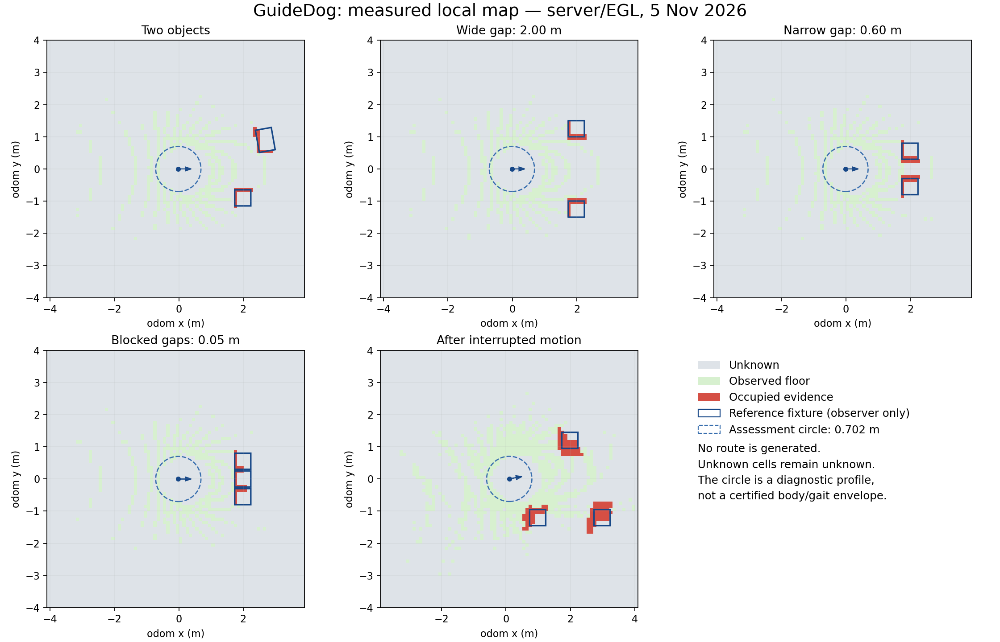

# Проверка готовности карты к поиску пути — 5 ноября 2026

**Итог: геометрия четырёх неподвижных сцен прошла проверку в двух запусках.
Готовность к планировщику не подтверждена.** Две попытки проезда на 2 м
прерваны примерно после 14 см из-за ухода курса за заранее заданные 15°.
Под весь диагностический габарит нет связного наблюдаемого пола, а стартовая
ячейка остаётся неизвестной. Это результат проверки, а не разрешение ехать
по неизвестному пространству.

Ветка: `feat/map-validation`, родитель измерений: `62cb491` с изменённой
рабочей копией. Внешний симулятор остался чистым на
`55ff151632a0220bf3ae0c0772392615d86da7a8`. Контрольные суммы исходников во
время финальных заездов сохранены в
[метаданных](validation/map-readiness-20261105/measurement-provenance.json).

## Что добавлено

- Режим `--map-validation`: две коробки, широкий, узкий и перекрытый проходы,
  затем ограниченная попытка движения с тремя боковыми ориентирами.
- Независимый измеритель сравнивает клетки с известными прямоугольниками
  Gazebo. Каждая новая коробка получает отдельную положительную проверку
  датчика контакта уникальным падающим пробником ещё вдали от робота.
- Эталонная поза сопоставляется с точной меткой облака без экстраполяции;
  допустимый интервал опорных поз — не более 60 мс времени источника.
  Единственное преобразование эталон → odom фиксируется до серии и дальше
  не подгоняется. Эталон не поступает в узел карты или защиту LiDAR.
- Карта и статус сопоставляются по содержимому через `snapshot_digest`,
  координатам и метке. Старение клеток может изменить карту при прежней
  метке: одного совпадения времени недостаточно. Наблюдатель дополнительно
  учитывает время хранения статуса у себя. Проверки ждут цельный снимок,
  не перечитывая его между условиями из разных ROS callback.
- Анализ связности учитывает неизвестные клетки, края карты и весь круг
  радиусом 0,702 м. Это предложенный диагностический профиль вокруг
  настроенного прямоугольника корпуса с запасом 0,10 м; физический корпус,
  походка и габарит человека им ещё не подтверждены.
- Режим `--headless` запускает сервер Gazebo с EGL без окна и без переменных
  `DISPLAY`/`XAUTHORITY`. Адаптер меняет только аргументы одного включения
  Gazebo в закреплённом внешнем launch. Датчики, мосты, контроллеры и мир
  сохраняются; неоднозначная структура внешнего launch вызывает отказ.
  Обычный запуск с окном остаётся профилем по умолчанию.

Классификация клеток, сроки свежести, QoS LiDAR, предел скорости 0,05 м/с,
дистанция STOP 0,80 м и защита потери команд не менялись. Карта по-прежнему
не публикует команды движения. Повороты и объезд не включены.

## Условия и заранее заданные критерии

Ubuntu 24.04 ARM64 в UTM, ROS 2 Jazzy, Gazebo Sim 8.15.0, 4 ГиБ RAM.
RGB отключён. Все новые заезды выполнены последовательно в профиле
`server_egl`; Gazebo сообщил о программном резервном пути EGL (`kms_swrast`).
Этот профиль не объединяется с прежними результатами графического окна.

[Протокол](map-readiness-protocol.md) зафиксирован до расширенной серии.
На объект нужно минимум три связанные с ним занятые клетки, p95 ошибки
границы ≤0,20 м, максимум ≤0,30 м. Свободных клеток, целиком лежащих внутри
эталонных коробок, быть не должно. На статичную сцену нужны три разных
свежих снимка. Остальные критерии и ограничения движения приведены в протоколе.
В повторе допуски, сцены и правила карты не ослаблялись.

## Неподвижные сцены: оба запуска прошли

Таблица показывает худший результат среди трёх снимков каждого запуска и
связанных с объектами клеток. Ошибка условна на сопоставление ближайшей
границе в радиусе 0,50 м; это не глобальная точность карты и не полнота
распознавания произвольных объектов. Несопоставленных занятых клеток в этих
статичных наблюдениях — ноль.

| Сцена | Геометрический зазор | Наибольшая p95 ошибки границы | Наибольшая отдельная ошибка | Результат геометрии |
| --- | --- | --- | --- | --- |
| Две коробки, вторая повёрнута на 10° | Не оценивался как проход | 5,82 см | 6,53 см | Пройдено дважды |
| Широкий проход | 2,00 м | 5,13 см | 5,31 см | Пройдено дважды |
| Узкий проход | 0,60 м | 6,11 см | 6,51 см | Пройдено дважды |
| Перекрытый проход | Два промежутка по 0,05 м | 6,19 см | 6,76 см | Пройдено дважды |

Во всех этих снимках — ноль свободных клеток, целиком находящихся внутри
коробок. Неизвестный интерьер коробок не считался свободным. Подтверждения
контактов каждого пробника сохранены отдельно в `reference_boxes`.

Уже широкий проход геометрически вмещает диагностический круг, но **ни одна
из четырёх сцен не подтверждает доступный наблюдаемый путь**. Фактический
старт неизвестен; полностью наблюдаемых положений круга — ноль. Видимые
участки пола разделены пробелами, в том числе около робота. Неизвестный старт
не переносился на ближайшую зелёную клетку. Проверки на искусственных сетках
отдельно подтверждают положительный широкий проход, отказ узкого прохода
для габарита и запрет диагонального срезания углов; сцены Gazebo пока
не дают положительного примера связного пола.



## Попытки движения: цель 2 м не достигнута

Запрос — прежние 0,05 м/с вперёд, без поворота. Наблюдатель прерывает
попытку при уходе курса за 15°, боковом отклонении за 0,30 м, недопустимой
высоте, контакте, запрете LiDAR или превышении срока. Это ограниченный
экспериментальный надзор, не доказанная физическая защита.

| Измерение | Запуск 1 | Запуск 2 |
| --- | --- | --- |
| Продвижение при вмешательстве | 0,144 м | 0,139 м |
| Отклонение курса при вмешательстве | 17,02° | 15,09° |
| Максимальное боковое отклонение до вмешательства | 0,034 м | 0,031 м |
| Итоговое продвижение после остановки | 0,142 м | 0,150 м |
| Наблюдаемый ноль выходной команды после запроса остановки | 0,112 с | 0,063 с |
| Продвижение после первого наблюдаемого нуля | 0,0030 м | 0,0028 м |
| Согласованных измерений карты во время движения | 2 | 1 |

Оба результата — `motion_envelope_intervention`. Во втором запуске отдельно
записано ноль контактов робота с препятствиями; положительные проверки
контактов прошли. Частота наблюдения конечна: предел 15° — порог вмешательства,
а не гарантия, что реальная поза никогда его не превысит.

После движения ошибки карты выросли. Худшая p95 по коробке: 0,249 м в первом
запуске и 0,207 м во втором; максимум в первом — 0,306 м. Это выше критериев.
При этом ошибка положения odom в финальных парных снимках была 0,013 и
0,038 м. Причина роста ошибки карты ещё не установлена: результат не
приписывается автоматически одной одометрии, TF или модели походки.
Двух попыток недостаточно для статистической оценки надёжности.

## Ресурсы и регрессии

Массивы клеток — 179 200 байт (около 175 КиБ); p95 времени обработки в
статичных измерениях — до 2,82 мс. Это время декодирования/преобразования,
подгонки пола и изменения массива, без ожидания TF и отрисовки отчёта.
Память не включает весь процесс Python или виртуальную машину.

В последнем окне второго запуска LiDAR получен примерно с 9,66 Гц по
настенным часам и 10 Гц по исходным меткам полученных сообщений.
Снимок всей VM: 42,7% занятости CPU за около 5 с и 1958 МиБ доступной RAM.
Это отдельное окно серверного профиля, не среднее всего заезда, не доказательство
отсутствия потерь сообщений и не контролируемое сравнение скорости GUI/EGL.
RGB и совместная нагрузка остаются отдельной задачей.

Прежние сценарии дополнительно выполнены с картой и тем же серверным профилем:

- **STOP прошёл:** свободный и боковой путь, передняя коробка, запрет самопроизвольного
  возобновления, потеря LiDAR и команд. Итоговый зазор в проверяемом коридоре —
  0,822 м; наблюдаемый ноль при потере LiDAR — 1,497 с, команд — 0,442 с.
  Контактов робота с препятствием — ноль.
- **Прежняя карта прошла:** продвижение 0,091 м, смещение окна, сохранение
  препятствия при коротком пропадании, переход всех 6400 клеток в неизвестное
  состояние без обновления исходной метки, восстановление и очистка двух
  бывших занятых клеток новыми наблюдениями пола. Контактов — ноль.
- **Автотесты:** 87 прошли, один ранее отключённый пропущен. Четыре предупреждения
  относятся к `fork` внутри проверки стиля. Добавлены проверки связности,
  габарита, ложного свободного пространства, точного сопоставления карты/статуса
  и реального API внешнего launch. Начальные ошибки новых тестов/отступов и их
  журналы сохранены в полном архиве; финальный набор без падений.
- После серии не осталось процессов симуляции, карты и защиты; внешний
  репозиторий симулятора не изменён.

Все времена нулевой команды — наблюдения ROS-подписчика по его часам,
не синхронизированная задержка от физического датчика до привода.

## Повторить и найти отчёты

После сборки пакета в Ubuntu:

```bash
~/guidedog_ws/src/GuideDog-Go2/scripts/test_obstacle_demo.sh --map-validation --headless
```

Для графического запуска убери `--headless`; нужен разблокированный рабочий
стол. Запускай только одну симуляцию одновременно. Бенчмарк напечатает каталог
под `~/.ros/guidedog/reports/`. При неподтверждённой готовности он завершится
с кодом 1; это ожидаемый измеренный исход. Открой `benchmark.json`,
`map-*.svg`/`map-*.json` и `motion-trace.jsonl`. Последний снимок обычной карты —
`session/mapping/local_map.svg`.

Ключевые данные в Git:

- [Запуск 1](validation/map-readiness-20261105/benchmark-readiness1.json),
  [запуск 2](validation/map-readiness-20261105/benchmark-readiness2.json).
- [Повтор STOP](validation/map-readiness-20261105/benchmark-stop-regression.json),
  [повтор карты](validation/map-readiness-20261105/benchmark-map-regression.json).
- [Финальная карта после остановки](validation/map-readiness-20261105/map-long-final.json),
  [отчёт датчиков](validation/map-readiness-20261105/sensor-report-readiness2.json),
  [тесты](validation/map-readiness-20261105/pytest.xml).

Полные каталоги Ubuntu: `map-readiness-headless1-20261105`,
`map-readiness-headless2-20261105`, `map-readiness-stop-regression-20261105`,
`map-readiness-map-regression-20261105` под `~/.ros/guidedog/reports/`.
На Mac: `output/guidedog-map-validation-20261105/` — полные архивы обоих
заездов, исходники на момент измерения, журналы промежуточных ошибок,
контрольные суммы и Git bundle. Итоговый коммит фиксируется снаружи
репозитория в манифесте этой резервной копии.

## Следующий рабочий цикл

Сначала отдельно измерить и исправить уход курса при прямом запросе:
сравнить фактическую позу, команды контроллера, IMU/odom и ход времени,
не увеличивая допустимый угол ради успешного заезда. Затем повторить тот же
2-метровый критерий и проверить рост ошибки карты при движении.

Следом — обоснованный источник подтверждений пола и контракт старта в слепой
зоне. Потребуется положительный наблюдаемый коридор под габарит, сохранение
отказа при узком/неизвестном проходе и явный срок действия подтверждений.
Просто заполнить промежутки свободными клетками нельзя.

Только после этих проверок — предварительный просмотр маршрута без команд
роботу. Автоматические повороты, объезд, рельеф, лестницы, человек и физический
Go2 Air этим этапом не проверялись.
