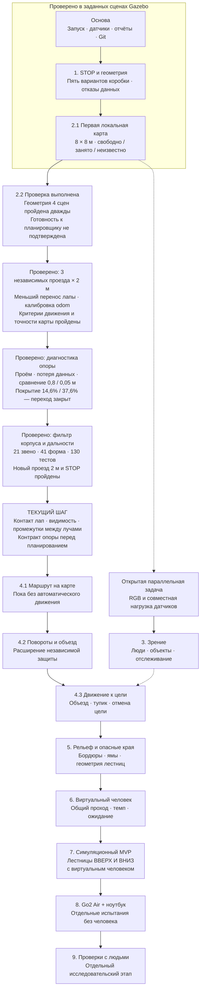

# GuideDog-Go2: рабочая карта развития

Версия 1.8 · 6 ноября 2026 · часовой пояс Asia/Shanghai.

**На следующую рабочую сессию:** по просьбе пользователя сначала напомнить
о слишком ранней остановке перед коробкой: визуальное расстояние/порог/причина
STOP и последующая измеренная калибровка. Задача отложена, настройки не изменены.
Детали и статус напоминания — в [PROJECT_SESSION.md](next-session.md).

Эта карта связывает текущий код, результаты заездов, план репозитория и обсуждавшиеся исследования. Это порядок разработки с проверяемыми результатами. Даты завершения и готовность будущих функций не предполагаются заранее.

## Цель и принятая основа

Первая большая цель — функциональный прототип **в симуляции**: робот достигает заданной цели, обходит препятствия, учитывает сопровождаемого человека и проходит заданные лестницы **вверх и вниз** с виртуальным человеком. Затем отдельно проверяем перенос на настоящий Go2 Air и возможность испытаний с людьми.

- Текущая разработка: Ubuntu 24.04 ARM64 в UTM на Mac, ROS 2 Jazzy, Gazebo Harmonic.
- Основной проект: [AchillesJS/GuideDog-Go2](https://github.com/AchillesJS/GuideDog-Go2).
- Предыдущая основа: [коммит 183eb23](https://github.com/AchillesJS/GuideDog-Go2/commit/183eb236f0777ad3f228461caf1a67e0ba09ed96), ветка `feat/lidar-stop`.
- Предыдущая проверенная и опубликованная работа: [коммит 62cb491](https://github.com/AchillesJS/GuideDog-Go2/commit/62cb4919676af870d836b6cfa90ca6e8ff25f0a9), ветка [feat/local-map](https://github.com/AchillesJS/GuideDog-Go2/tree/feat/local-map) в Ubuntu, на GitHub и в копии репозитория `GuideDog-Go2/` на Mac. Наличие этого коммита в вершине ветки проверено при обновлении карты. База карты — `d5c2a43`; затем исправлены запуск GUI, повторный старт и очистка процессов. Ветка на четыре коммита впереди `main`, объединение ещё не выполнено. Резервные копии — `output/guidedog-local-map-20261105/` и `output/guidedog-gui-fix-20261105/`.
- Предыдущий этап геометрии: коммит `fa7c1dd`, ветка `feat/clearance-validation`, резервная копия `output/guidedog-geometry-20261105/`.
- Предыдущий локальный этап: коммит `8f022e0`, ветка `feat/map-validation` в Ubuntu и на Mac. Его коммит опубликован в истории `feat/straight-motion`; отдельная ветка `feat/map-validation` остаётся локальной. [Отчёт проверки готовности карты](map-readiness-validation.md) и полные архивы `output/guidedog-map-validation-20261105/` сохраняют два неудачных длинных заезда и успешные регрессии. Этот исходный отказ сохранён и опубликован вместе с последующими исправлениями.
- Текущий опубликованный этап: код `6f5de8d` и отдельный коммит пользовательского повтора `f0e19e9`, ветка [feat/straight-motion](https://github.com/AchillesJS/GuideDog-Go2/tree/feat/straight-motion) в Ubuntu, на Mac и GitHub. [Отчёт движения и одометрии](straight-motion-validation.md): три независимых проезда на 2 м прошли прежние критерии движения/карты; максимальный уход курса 3,91°, ошибка odom до 0,134 м. Настройки защищённого плоского запуска — `low_lift_calibrated`. Резервная копия измерений — `output/guidedog-straight-motion-20261105/`; опубликованная история — `output/guidedog-publication-20261105/`. [Черновик PR №18](https://github.com/AchillesJS/GuideDog-Go2/pull/18) направлен в `feat/local-map`, поскольку эта базовая ветка ещё не объединена с `main`. Метка возврата — `sim-straight-motion-20261105`.
- Исходная версия: [метка before-improvements](https://github.com/AchillesJS/GuideDog-Go2/tree/before-improvements).
- Внешний симулятор закреплён на `55ff151632a0220bf3ae0c0772392615d86da7a8`.
- Целевая аппаратная схема: Go2 Air и ноутбук, соединённые локальной Wi-Fi-сетью. Интернет во время работы не должен быть обязательным.
- Прежние материалы по EDU, ROS Humble, RealSense и Jetson остаются справочными. Их аппаратные предположения не становятся требованиями к текущей системе автоматически.

Основные решения взяты из [roadmap](https://github.com/AchillesJS/GuideDog-Go2/blob/main/docs/roadmap.md) и [архитектуры](https://github.com/AchillesJS/GuideDog-Go2/blob/main/docs/architecture.md). Нумерация ниже раскрывает эти вехи в более понятные практические шаги.

## Общая схема

Основная линия идёт сверху вниз. Блок «проверено» относится только к пройденным сценам и ограниченному профилю движения, а не ко всей готовности M0–M3. Серия **2.2** выполнена, но её входной критерий для планировщика не пройден: уход курса и точность карты уже проверены на трёх новых проездах; теперь обосновываем наблюдаемую опору и связность пола. Зрение можно готовить параллельно после проверки его нагрузки; для базового поиска пути сначала нужна геометрия. Ранняя проверка доступности интерфейсов конкретного Go2 Air проводится отдельно, ещё до будущих физических заездов. Полный сценарий сопровождения потребует совместной проверки всех нужных компонентов.

## Что уже проверено

- Go2 запускается в Gazebo, доступны управление и данные датчиков.
- Есть запуск симуляции с диагностикой времени, преобразований координат и ресурсов.
- Реализован ограниченный сценарий движения вперёд с остановкой перед коробкой.
- Проверены остановки при потере лидара и команд, а также явное повторное разрешение движения.
- В текущей локальной версии прошли 130 автоматических тестов; одна ранее отключённая проверка пропущена. Ранее прошли пять вариантов коробки и отказ неподдерживаемой скорости. В этапе карты прошли её сценарии и повторная полная проверка STOP с включённым картографированием. Проверки закрытия терминала/Gazebo и отказа повторного запуска сохранены; добавлены целостность снимков, оценка связности, серверный запуск, проверенный профиль прямого движения/одометрии и диагностика опорного пола.
- Добавлены автоматический отчёт покрытия пола и изображение диагностического габарита. По два неподвижных опыта каждого профиля проверили настоящий проём и потерю/восстановление LiDAR. Экспериментальная граница 0,05 м увеличила долю меток пола, но не подтвердила весь габарит. [Отчёт](support-evidence-validation.md), локальный коммит `6d54bff`, ветка `feat/support-evidence` на Mac и в Ubuntu; данные сохранены в `output/guidedog-support-evidence-20261105/`. В момент этих измерений работа сохранялась локально; актуальное состояние отражает история ветки.
- Есть первая локальная карта ровной сцены: 8 × 8 м, ячейка 0,10 м, свободно/занято/неизвестно, возраст, индикатор подтверждений и наблюдаемая высота/разброс пола. Карта не управляет движением.
- Исправлен ручной запуск после зависания: X11/XCB для Qt по умолчанию, отказ второго запуска в том же канале, очистка процессов при закрытии терминала и выходе Gazebo. Причины графического зависания по отдельности пока не сравнивались.
- Первый этап карты опубликован в `feat/local-map`; отчёты серий 2.2 и прямого движения сохранены локально в `feat/straight-motion` вместе с историей `feat/map-validation`; есть исходная метка возврата и проверенные резервные копии Git на Mac. Это не подтверждение повторного прогона коллегой.

Это части M0, M2 и M3, а не завершение всех этих вех. Старые значения 0,61–0,74 м оказались продольной проекцией всей коробки; часть её ближайшего угла при повороте выходила за коридор, который измеряет LiDAR. В новой серии сравниваются одинаковые коридоры и метки времени: конечный зазор 0,816–0,852 м при пороге 0,80 м, столкновений нет. Старые сырые отчёты сохранены без пересчёта. LiDAR при RELIABLE получил все native-метки в двух общих окнах сравнения; RGB-часть PERF-001 остаётся открытой. Подробности: `output/guidedog-geometry-20261105/REPORT_RU.md` и `docs/clearance-validation.md` в новой ветке Ubuntu.

## Этап 1. Точная геометрия и повторяемая остановка — серия проверена

**Состояние на 5 ноября:** метрики приведены к одному коридору и времени; добавлены независимые эталонные наблюдения и заранее заданные критерии. Пять вариантов коробки прошли при запросе 0,05 м/с. Скорость 0,03 м/с дала боковой уход и теперь отклоняется; её исправление не заявляется. Подгонка плоскости пола исправлена с сохранением обязательных точек пола впереди в текущем кадре. Отказы лидара/команд и повторное разрешение движения проверены. Коллеге ещё предстоит повторить запуск; RGB, другие позы, поверхности и скорости не закрыты этой серией.

**Что делаем:** проверяем положение лидара, координаты и время наблюдений, оценку позы и границы корпуса; выясняем причину разницы между оценкой и фактическим зазором. Разделяем задержки Gazebo, моста и ROS. Добавляем заезды с разными размерами и положениями препятствий, начальными позами и разрешёнными скоростями. Перед серией фиксируем допустимую погрешность и минимальный зазор.

**Переходим дальше, когда:** причина погрешности установлена или её пределы измерены и учтены; заданная серия соответствует заранее установленным критериям. Отчёт содержит минимальный фактический зазор, столкновения, ложные остановки, паузы датчиков, задержки команд и случаи вмешательства. Коллега воспроизводит запуск из зафиксированной версии.

**Что изучать по ходу:** NumPy, XYZ и системы координат, TF, метки времени, ROS QoS, различие заданной скорости и фактического движения. Это закрывает оставшиеся вопросы базовой вехи M0.

## Этап 2. Локальная карта рядом с роботом — первый вариант проверен

**Первый вариант проверен 5 ноября:** коробка отображается в odom, сетка сохраняет её при движении робота, скрытый за коробкой пол остаётся неизвестным. При потере LiDAR препятствие удерживается на короткое время, затем данные истекают в неизвестное состояние. После удаления коробки свободные ячейки появляются по новым наблюдениям пола. p95 ошибки границы коробки после движения — 9,6 см; массивы ячеек — около 175 КиБ. Отчёт: `GuideDog-Go2/docs/local-map-validation.md`. Полная веха M2 остаётся открытой: рельеф, наклон, края/лестницы, калиброванная неопределённость и связь с планировщиком ещё не реализованы.

**Что делаем:** строим небольшую перемещающуюся вместе с роботом карту. В ней различаются свободные, занятые и неизвестные участки, высота поверхности, препятствия над полом, давность и достоверность наблюдений. Размер и разрешение выбираем по измерениям нагрузки; примерно 10 × 10 м из исходного плана — гипотеза для оценки, а не обязательная стартовая конфигурация.

**Переходим дальше, когда:** карта согласована с движением и одометрией; препятствия оказываются в ожидаемых местах; временная потеря обзора не стирает опасность мгновенно; устаревшие данные обрабатываются явно. Отсутствие точек не превращается в свободный проход. Известны расход памяти и время обновления.

**Что изучать:** облака точек, сеточные карты, оценку высоты и погрешности. Основная связь с планом — M2.

### Этап 2.2 — карта для последующего поиска пути: серия выполнена, переход закрыт

**Цель:** проверить, можно ли по карте уверенно различить наблюдаемый проход, препятствие и недостаток данных. Сразу передавать ей управление роботом пока рано: первая серия включала одну коробку и короткое измеренное продвижение около 10 см.

Порядок работы:

1. Заранее зафиксировать новые сцены: две-три коробки, узкий проход, перекрытый проход и более длинный проезд. Для длинного проезда выбрать дистанцию до испытания; стартовый вариант — 2–3 м по прямой в прежнем ограниченном профиле.
2. Измерить сохранение положения препятствий при движении и смещении окна карты, p95 и максимум ошибки границ, ложные свободные ячейки, полноту наблюдений, задержки и ресурсы. Сроки свежести и допуски фиксируем до серии.
3. Проверить **связность реально наблюдаемого пола** с учётом габаритов робота и выбранного запаса. Неизвестные и устаревшие ячейки в первом варианте поиска пути считаются недоступными.
4. Отдельно разобраться со слепой зоной LiDAR около робота и промежутками между наблюдаемыми ячейками. Источник подтверждений опоры и правила работы со стартовой ячейкой нужно обосновать; закрашивать эти пробелы свободными ради красивого маршрута нельзя.
5. Сохранить отчёт по всем сценам и согласовать, какие данные карты получает будущий планировщик, а при каких условиях он сообщает «недостаточно данных» или «пути нет».

**Результат цикла:** проверенный вход для планировщика и явный перечень оставшихся ограничений. Отсутствие наблюдаемого прохода — допустимый результат проверки, а не разрешение движения по неизвестному пространству.

**Измеренный результат 5 ноября:** две-три коробки, широкий, узкий и перекрытый проходы проверены дважды — геометрические критерии пройдены. Однако старт неизвестен и полностью наблюдаемого прохода под диагностический габарит нет. Две попытки проезда на 2 м завершились при продвижении 0,139–0,144 м: отклонение курса превысило заранее заданные 15°. После движения ошибка границ выросла выше критерия. Во втором заезде контактов робота с препятствиями — ноль. Результаты и критерии сохранены; они не ослаблялись.

**Обновление после диагностики:** уменьшение настройки переноса лапы 0,040 → 0,015 м устранило срыв прямого движения в проверенных ровных сценах. Отдельный калибровочный заезд дал фиксированный масштаб odom 1,60 вместо 0,90. Три независимых проверочных заезда на 2 м прошли прежние пределы движения и геометрии, ложных свободных клеток целиком внутри эталонных коробок — ноль. Регрессии STOP/короткой карты пройдены. Это ограниченный профиль симуляции, не аппаратная калибровка.

**Обновление 6 ноября:** выполнена диагностика слепой зоны: в исходной модели min=0,8 м, отдельный профиль min=0,05 м меняет только дальность в временной модели. Во вторых запусках доля меток пола в прежнем габарите составила 14,6% и 37,6%; обе оставили неизвестный старт. Настоящий проём 0,6 × 0,6 м остался неизвестным (0 ложных свободных внутренних клеток), blackout/TTL/recovery прошли. Рабочая карта сохраняет прежнюю классификацию. Точки на min/max отдельно исключаются пока только новым независимым наблюдателем; около 2900 ближних кандидатов в маске корпуса не считаются подтверждённым полом. Это завершённая проверка диагностики, не прохождение критерия связности.

**Следующее обновление 6 ноября:** фильтр внедрён и проверен. Насыщенные min/max не подтверждают пол, но сохраняются кандидатами в препятствия для STOP. Карта использует 21 звено/41 visual и collision форму на точную метку облака, проверяет SHA-256 шести mesh. Подтверждены отказы при пропавшем TF и повреждённой модели. Ближний профиль с geometry дал 56,9% меток пола в габарите против 37,6% с прежним прямоугольником; в проёме ложных свободных клеток нет. Новый проезд 2,003 м прошёл прежние критерии: максимальный курс 6,31°, odom до 0,075 м, контактов нет. [Отчёт](robot-cloud-filter-validation.md), локальный коммит `4e1922d`, ветка `feat/robot-cloud-filter` на Mac и в Ubuntu, архив `output/guidedog-robot-cloud-filter-20261106/`.

**Текущий следующий цикл:** обосновать отдельный контракт опоры: контакты лап, видимость/тени и поддержку между редкими лучами. Контакт лапы не доказывает наличие пола между лапами или непрерывность маршрута человека. Проверить отрицательные случаи проёмов/краёв и отсутствия данных, затем повторить прежнюю серию связности. Положительный коридор под весь прежний габарит пока не подтверждён; неизвестный старт не заполняется свободным.

**После этого:** простой маршрут на карте в режиме предварительного просмотра, без управления движением. Затем — проверенные повороты и расширение защиты на всё пространство, занимаемое роботом; только после них — замкнутый сценарий объезда к цели. Это подпункты этапа 4, а не уже готовая навигация.

## Этап 3. Зрение: люди и объекты — параллельная линия

**Что делаем:** после измерения бюджета ресурсов подключаем один небольшой детектор. Передаём класс, уверенность, время и координаты наблюдения. Добавляем простое отслеживание и состояние потери человека. Связываем камеру с геометрией только после проверки взаимного положения и синхронизации.

**Переходим дальше, когда:** измерены ошибки, частота и задержка на нашей VM; неверный или устаревший результат явно обозначается; распознавание не нарушает сроки работы остановки. Нераспознанный объект может оставаться геометрическим препятствием.

**Что изучать:** OpenCV, вывод готовой модели, метрики детекции, калибровку камеры и лидара. Это M1 и часть объединения данных в M2. Собственное обучение модели пока не является обязательным.

## Этап 4. Движение к цели и объезд на ровном полу

**Что делаем:** проверяем контролируемые повороты и соответствующую проверку всего пространства, занимаемого роботом при движении. Подключаем простой классический планировщик или подходящую конфигурацию Nav2. Сценарий: цель → обнаружение коробки → объезд → возвращение к движению к цели. Добавляем отмену цели, заблокированный проход и ограниченное восстановление после неудачи.

**Переходим дальше, когда:** робот достигает цели в заданных сценах без контактов; при отсутствии пути сообщает об этом и останавливается; не повторяет бесконечно одни и те же попытки. Проверены ошибки планировщика и его зависание. Независимая остановка остаётся последним ограничением команд движения.

**Что изучать:** поиск пути, стоимость прохода, Nav2, управление целями и восстановление. Это первая часть M3. Нынешняя защита только движения вперёд не считается готовой защитой для поворотов.

## Этап 5. Рельеф, бордюры, ямы и распознавание лестниц

**Что делаем:** расширяем карту высот; обнаруживаем подъёмы, спуски, края, ямы, наклоны и недостаточный просвет сверху. Для лестницы оцениваем начало и конец, направление, высоту и глубину ступеней, ширину прохода, уверенность и границы видимости.

**Переходим дальше, когда:** на заданных сценах есть измерения ошибок и пропусков, включая лестницы вниз. При недостатке данных робот останавливается перед непроверенным участком. Небольшие края, исчезающие при огрублении карты, проверяются по исходной геометрии. Распознавание лестницы ещё не разрешает движение по ней.

**Что изучать:** геометрию поверхностей, проходимость, отрицательные препятствия и оценку неопределённости. Это оставшаяся геометрия M2 и остановка перед входом из M3.

## Этап 6. Поведение относительно человека — сначала в симуляции

**Что делаем:** вводим виртуального сопровождаемого человека с собственными габаритами, темпом и задержкой остановки. Планируем общий проход для робота и человека, включая пространство для головы и плеч. Добавляем ожидание, потерю контакта/наблюдения, сообщения об опасности, подтверждение и команду остановки. Учитываем других пешеходов.

**Переходим дальше, когда:** сценарии учитывают контакты человека отдельно от контактов робота; робот ждёт отставшего человека и корректно реагирует на его потерю. Отдельно задаём и проверяем предположения о ручке, относительном положении и канале команд.

**Что изучать:** отслеживание человека, автоматы состояний, совместное планирование и взаимодействие с пользователем. Это часть M4. Консультации с пользователями и специалистами для уточнения требований можно начать раньше; это отдельная работа от физических испытаний сопровождения.

## Этап 7. Лестницы с виртуальным человеком и итоговый симуляционный MVP

**Что делаем:** объединяем распознавание рельефа, навигацию, модель человека и управление состояниями: подход → остановка → оценка → подтверждение → подъём/спуск → площадка → выход. Проверяем устойчивое прерывание и восстановление на ступени. В симуляторе должны быть продемонстрированы подходящие средства низкоуровневого движения; способность нынешнего CHAMP-сценария к лестницам не предполагается.

**Переходим дальше, когда:** отдельно пройдены подъём и спуск по нескольким заранее заданным лестницам, в том числе с виртуальным человеком и отказами. Отчёт включает падения, контакты, вмешательства, ошибки геометрии и устойчивость остановки. Посылка нулевой скорости сама по себе не доказывает устойчивость на лестнице.

**Итог этой вехи:** функциональный прототип в симуляции по M0–M4. Это ещё не подтверждение возможностей настоящего Go2 Air.

## Этап 8. Go2 Air и ноутбук — отдельная аппаратная проверка

**Ранняя параллельная задача:** уже при уточнении платформы проверить точную редакцию Air, прошивку, доступные датчики, интерфейс команд, режимы движения и ограничения. Выявленный запрет доступа или отсутствие нужного режима — причина пересмотреть платформу/адаптер, а не ждать окончания всей симуляции.

**Последовательность испытаний:** чтение датчиков → проверка остановки на стороне самого робота и обрыва связи → ручное ограниченное движение по ровному полу → препятствия → лестницы вверх и вниз без человека. До автономного движения должны быть выполнены соответствующие аппаратные проверки.

**Переходим дальше, когда:** конкретный робот подтвердил доступность интерфейсов, поведение при потере Wi-Fi и команд, динамику движения и торможения, устойчивость и восстановление на испытанных лестницах. Зависание или отключение ноутбука проверяется отдельно от программного watchdog на ноутбуке.

**Что изучать:** адаптер Unitree, сеть и DDS, синхронизацию часов, калибровку, воспроизведение команд и проверку обратной связи. Это M5; результаты EDU или другого Go2 не подменяют измерения нашего Air.

## Этап 9. Проверки с людьми

**Что делаем:** разрабатываем отдельный протокол с профильными специалистами и пользователями. Проверяем механику ручки, связь с человеком, понятность сообщений, удобный темп, реакции на ошибки и физическое взаимодействие.

**Результат:** данные ограниченных испытаний и явно определённые условия применения. Симуляционные тесты и испытания робота без человека не заменяют эту работу. Готовность к самостоятельному использованию как средства мобильности не предполагается исходным MVP.

## Как статьи связаны с этапами

Ниже — выбранные материалы из прошлых обсуждений, использованные при исходном составлении карты. В версии 1.8 добавлены фильтр геометрии/дальности и новый двухметровый проезд; следующий цикл уточнён по оставшимся пробелам опоры. Публикация предыдущего этапа сохранена по подтверждённому снимку версии 1.6; новая проверка публикаций не проводилась. Перенос идеи в наш проект — предложение по архитектуре, а не доказательство совместимости реализации. Полный доступный указатель подборок вынесен в `output/guidedog-roadmap-20261105/materials-index.md`.

| Материал | Что берём в наш план | Когда |
| --- | --- | --- |
| [Milo](https://arxiv.org/abs/2607.19530) | Связь локальной геометрии, навигации и учёта сопровождаемого человека; отдельные результаты для робота и человека | 2, 4, 6–7 |
| [Nav2 Jazzy: Navigation Servers](https://docs.nav2.org/jazzy/getting_started/navigation_concepts/navigation_servers/) | Разделение планирования, выполнения и восстановления после ошибок | 4 |
| [Nav2 Jazzy: Collision Monitor](https://docs.nav2.org/jazzy/configuration_and_development/configuration_guide/core_servers/collision_monitor/) | Независимое ограничение выходных команд по данным датчиков | 1, 4–8 |
| [LERR-Nav](https://arxiv.org/abs/2610.15362) | Распознавание отсутствия прогресса, ограниченное восстановление и память о попытках; сначала реализуем простые правила | 4; обучаемая версия позже |
| [Terrain Traversability](https://arxiv.org/abs/2609.39755) | Различие геометрии и взаимодействия с поверхностью, учёт неопределённости | 5; обучение на физическом опыте позже |
| [Social Navigation for Tour-guide Robot](https://arxiv.org/abs/2610.05455) | Учёт положения и поведения следующего за роботом человека | 6 |
| [GuideNav](https://guidedogrobot-navigation.github.io/) | Требования пользователей и взаимодействие; воспроизведение заранее показанных маршрутов как отдельный будущий вариант | Требования — рано; реализация 6, 9 и расширения |
| [EIDA](https://arxiv.org/abs/2610.01219) | Измерение соответствия между командой и фактическим движением при переносе на робот | 1 и 8 |
| [AVALON](https://arxiv.org/abs/2610.21586) | Топологические маршруты по зданию и проверка достижения ориентиров | Расширение после базовой навигации |
| [From Language to Navigation Goals](https://arxiv.org/abs/2607.13624) | Преобразование языкового запроса в проверяемую цель навигации; требования RGB-D в работе проверяем отдельно для нашей платформы | Расширение после базовой навигации |

Вывод для нашего порядка: сначала измерения, геометрия, классическая навигация и модель человека. Большие языковые модели, RL, сложные предикторы, глобальный SLAM и дополнительный вычислитель добавляются при конкретной необходимости и после сравнения с уже работающей базой. Они не являются обязательными условиями начала проекта. Глобальный маршрут по университету — отдельное расширение поверх локального объезда.

## Одинаковый порядок работы на каждом этапе

1. Выбираем один сценарий и заранее задаём критерии его прохождения.
2. Реализуем минимальное необходимое изменение в отдельной ветке.
3. Выполняем проверки кода, заезды и проверку отказов, относящиеся к изменению.
4. Сохраняем отчёт, параметры, версию Git и условия запуска; учитываем неудачные попытки.
5. Сохраняем коммит/точку возврата. Коллега воспроизводит существенные изменения перед объединением.

Этап становится завершённым по измерениям и воспроизводимости, а не только по успешному показу одного заезда. Перед изменением ограничений скорости или задержки проверяем их влияние на движение.

## Выполненный цикл и оставшиеся проверки

- [x] Проверить расхождение 0,80 м по оценке лидара и 0,61–0,74 м по модели корпуса: обнаружено смешение метрик.
- [x] Разделить влияние TF/позы, выборки облака и движения после нулевой команды в одинаковом коридоре и времени. Габариты физического робота не проверялись.
- [x] Зафиксировать параметры, допустимую ошибку и критерий зазора до финальной серии.
- [x] Расширить автоматические заезды и отчёт; сохранить неудачные попытки.
- [x] Сравнить native/ROS LiDAR по общим меткам; проверить RELIABLE при движении.
- [ ] Повторить аналогичный профиль для RGB и совместной нагрузки камеры/лидара.
- [x] Сохранить новую локальную точку возврата и резервную копию после успешной проверки.
- [x] Опубликовать текущий коммит `62cb491` в ветке `feat/local-map`; наличие на GitHub проверено.
- [x] Реализовать и проверить первый вариант локальной карты и её совместную работу со STOP.
- [x] Восстановить ручной запуск Gazebo и проверить завершение сессий/отказ второго запуска.
- [ ] Дать коллеге повторить текущий запуск перед объединением ветки.
- [x] Выполнить серию 2.2: несколько препятствий, две ограниченные попытки длинного движения и проверка достаточности карты. Результат — готовность не подтверждена.
- [x] Исправить профиль прямого движения и откалибровать odom; пройти прежние критерии движения и точности карты в трёх независимых проездах на 2 м.
- [x] Добавить диагностику покрытия опорного пола и выполнить по два неподвижных опыта исходной/ближней модели, с реальным проёмом и отказом данных; повторить STOP и короткую карту.
- [x] Проверить фильтрацию насыщенных дальностей в рабочем пути и собственную геометрию по модели/TF, включая отсутствие TF и попадания в защитные формы лап.
- [ ] Обосновать контакты лап, видимость и поддержку между лучами как отдельные виды свидетельств; проверить края и проёмы перед повторной оценкой связности.
- [ ] Обосновать наблюдаемую опору/старт в слепой зоне и подтвердить положительный связный коридор под габарит.
- [x] Опубликовать `feat/straight-motion` до `f0e19e9`, включая `6f5de8d` и `8f022e0`; создать метку `sim-straight-motion-20261105` и черновик PR №18. Основная ветка осталась на `ad49960`.
- [x] Сохранить успешный пользовательский повтор на чистом `6f5de8d`: 2,000 м, максимальный уход курса 3,51°, контактов нет.
- [ ] Согласовать контракт карты для будущего планировщика и реализовать предварительный просмотр маршрута.

В ручном контрольном запуске после восстановления GUI симуляция шла примерно с коэффициентом 0,24–0,26 от реального времени: LiDAR поступал около 2,46–2,56 Гц по настенным часам при 10 Гц по времени источника. Это не тот же показатель, что пропуски ROS/DDS; ускорение GUI этим исправлением не доказано. В новой серверной серии последнее окно показало примерно 9,66 Гц по настенным часам и 10 Гц по исходным меткам полученных сообщений; это другой профиль, без контролируемого сравнения с GUI. Обе шкалы и свежесть сохранены в отчётах. Профиль RGB/совместной нагрузки и повтор коллегой остаются открытыми.

Текущая основная линия — **контракт контактов/видимости/межлучевой опоры → связный наблюдаемый пол → повтор критерия готовности карты**. Геометрический фильтр и насыщения уже проверены; это не подтверждение полной опоры или готовности планировщика. Прямое движение и точность карты уже прошли три независимых двухметровых заезда в выбранном профиле. После прохождения этих критериев — **маршрут без автоматического движения → защищённые повороты → объезд к цели**. Первый вариант карты и STOP вместе уже проверены. Детектор, рельеф, лестницы, виртуальный человек и физические испытания сохраняют своё место дальше по карте.
