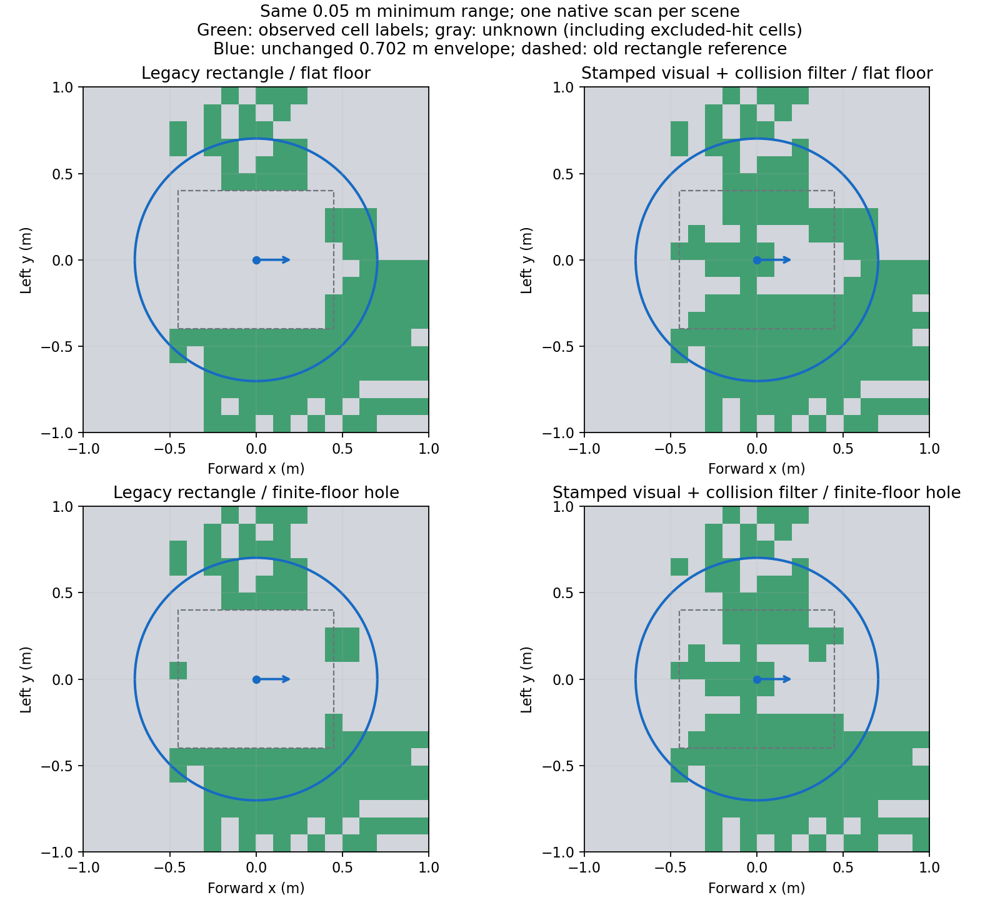

# Проверка фильтра корпуса и дальности — 6 ноября 2026

**Фильтр перенесён в работающую карту; STOP больше не использует насыщенные
дальности как подтверждение пола.** Прошли 130 тестов, три неподвижных опыта,
STOP с работающей картой, короткая карта и один прежний проезд на 2 м.
Наблюдаемый пол под весь габарит ещё не подтверждён; планировщик остаётся закрыт.

Ветка `feat/robot-cloud-filter`, родитель `6d54bff`. Внешняя зависимость осталась
чистой на `55ff151632a0220bf3ae0c0772392615d86da7a8`. Критерии заданы в
[протоколе](robot-cloud-filter-protocol.md), команды и контракт — в
[инструкции](robot-cloud-filter.md). В Git включена
[сводка всех семи запусков](validation/robot-cloud-filter-20261106/summary.json),
включая неудачную первую попытку.

## Что проверяет фильтр

Используются **21 звено и 41 visual/collision форма** фактического
`robot_description`, включая визуальные части вне коллизионных примитивов.
Для каждого принятого облака нужны все 21 TF на его метку; последний доступный
набор не подставляется. Шесть mesh проверяются по SHA-256. Их внешние границы
получены через `gz::common::MeshManager` 5.9.0 с учётом преобразований COLLADA;
повторный экспорт инструментом из репозитория дал побитово тот же каталог.
Загрузка COLLADA описана в
[исходном коде Gazebo Common](https://github.com/gazebosim/gz-common/blob/gz-common5/graphics/src/ColladaLoader.cc).

Запас к формам **2 см** зафиксирован до опытов. Mesh представлен внешним
параллелепипедом, поэтому фильтр может исключать и пустое пространство рядом
с настоящей поверхностью. Это консервативная потеря данных, не точная
классификация каждого отражения как детали робота.

Насыщения min/max исключаются из положительных подтверждений пола в карте
и STOP. В STOP эти конечные точки остаются кандидатами в препятствия;
геометрический self-фильтр карты не удаляет их из независимого veto.
В карте проекция любой исключённой точки запрещает свободную метку этой
клетки и не очищает старое препятствие. Поддержка между лучами не достраивается.

## Три неподвижных опыта

Каждый опыт начинался в новой headless-сцене. После успокоения собрано по
15 разных подходящих сканов ровного пола и по 15 после создания реального
проёма 0,6 × 0,6 м. В будущем проёме до удаления пола есть положительные
точки, после удаления — ноль. Эталон Gazebo использует только наблюдатель;
все принятые сканы этой серии имели точную эталонную позу без интерполяции.

| Профиль и фильтр | Пол в габарите, ровная сцена | Неизвестные клетки | Ложные свободные клетки проёма |
| --- | --- | --- | --- |
| `pinned` 0,8 м + geometry | 21 / 187 = **11,2%** | 166 | **0 из 16** |
| `l1_near` 0,05 м + legacy_body | 70 / 186 = **37,6%** | 116 | **0 из 16** |
| `l1_near` 0,05 м + geometry | 103 / 181 = **56,9%** | 78 | **0 из 16** |

Это снимки накопленной карты, не средние по всем сканам и не сплошная площадь
безопасного пола. Число клеток круга меняется при его смещении относительно
сетки. По одному опыту каждого варианта не устанавливает статистическую
надёжность. Ближняя модель с двумя фильтрами имеет одинаковое дерево URDF;
частота, углы, шум, физика и параметры походки не менялись.

На ближнем профиле в расширенные формы попадало 7271–7287 точек скана ровной
сцены, после совокупной фильтрации сохранялось 5446–5462. Пересечение исключений
диапазона и корпуса учитывается один раз при выборе сохранённых точек;
суммировать отдельные счётчики исключений нельзя. Часть сохранённых точек пола
теперь находится под прежним прямоугольником. Проекции удалённых точек, лапы
и оставшиеся пропуски продолжают оставлять серые клетки.

Во всех трёх опытах были только нулевые проверенные команды. Потеря потока
инвалидировала карту, после TTL меток пола в габарите не осталось, восстановление
возвращало свежие наблюдения. Корпус оставался на плите. Заезда к яме не было.

На рисунке показан независимый анализ одного скана в `base_footprint`, без
накопления TTL. Пунктир — прежний прямоугольник, голубой круг — неизменный
диагностический габарит. Рисунок иллюстрирует оставшиеся неизвестные области;
таблица выше относится к другим снимкам накопленной карты.

## Движение и регрессии

Профиль датчика для движущихся проверок — исходный `pinned`; походка
`low_lift_calibrated` и скорость запроса 0,05 м/с. Пределы движения, критерии
геометрии, габарит 0,702 м и правила STOP не смягчались.

| Проверка | Результат |
| --- | --- |
| Прежний двухметровый проезд | **2,003 м**, критерии пройдены |
| Максимальный уход курса, включая успокоение | **6,31°** при пределе 15° |
| Максимальный боковой уход | **0,120 м** при пределе 0,30 м |
| Худшая ошибка положения odom в парных снимках | **0,075 м** при пределе 0,20 м |
| Худшая p95 границы коробки / отдельная ошибка | **0,184 / 0,197 м** при пределах 0,20 / 0,30 м |
| Измерения карты при движении | **10 из 10**, плюс финальный снимок |
| Ложные свободные клетки внутри известных коробок | **0** |
| Контакты робота с препятствиями | **0** |

Один новый проезд подтверждает эту регрессию, не повторяет весь предыдущий
набор независимых калибровочных/проверочных заездов. Полная серия четырёх
статичных сцен готовности и заезды с `l1_near` в этом этапе не повторялись.

STOP с включённой новой картой прошёл: конечный зазор в одинаковом коридоре
0,824 м, контактов нет; измеренные задержки до нулевой команды при потере
LiDAR и команд — 1,556 и 0,449 с. Это результаты конкретного опыта, не
универсальные верхние границы задержек.

Короткая карта прошла: p95 границы после движения 0,049 м, обновление
с фильтрацией p95 8,72 мс. В двухметровом опыте конечный отчёт показывал
p95 11,57 мс; лимит 100 мс сохранён. Массивы сетки — 179200 байт.
Показатель охватывает обработку принятого скана, TF уже выбираются перед
измеряемым участком; это не полная стоимость всех callback/SVG/процессов.

## Ошибка первого запуска и автоматические проверки

Первый опыт `body-pinned-20261106` отказал до сбора подходящих сканов:
`mesh_outside_catalog_root`. В `ament --symlink-install` каталог mesh может
быть обычной директорией, а отдельные файлы — ссылками в исходный репозиторий.
Исправлена проверка соответствия URI ожидаемому установленному файлу после
разрешения ссылки; проверка SHA-256 сохраняется. В неудачной попытке карта
не приняла ни одного скана и не стала здоровой. Этот запуск сохранён рядом
с успешным `body-pinned2-20261106`; геометрия и запас не подстраивались.

Полный набор: **130 тестов прошли, 1 прежний пропущен**. Четыре предупреждения
линтера о `fork` в многопоточном процессе не привели к ошибкам тестов.
Проверены примитивы и повороты, visual вне collision, mesh/hash/scale,
символические ссылки, запрет исключённой клетки и сохранение препятствия.
В настоящей ROS-цепочке отсутствие одного TF не освежает карту, повреждение
модели сбрасывает её, а восстановление корректной модели возвращает наблюдения.
Старые проверки времени, replay, watchdog и завершения сессий сохранены.

Полные семь запусков, включая отказ, облака, все TF, версии исходников и
журналы находятся на Mac в `output/guidedog-robot-cloud-filter-20261106/`.
После переноса совпали SHA-256 всех 53 Python-файлов пакета. В репозиторий
включены сводка, рисунок и отдельные отчёты STOP/карты/проезда; raw-облака
и большой журнал движения остаются в резервном архиве.

## Что осталось перед планированием

Улучшение фильтра даёт больше обоснованных измерений под старым общим
прямоугольником, но не наблюдает весь пол под лапами и не доказывает поверхность
между лучами. Последний снимок двухметрового опыта сохранил `start_unknown`
и ноль полностью наблюдаемых положений прежнего диагностического габарита.
Поддержка контакта лап, видимость/тени и поддержка между разреженными точками
потребуют отдельного контракта и отрицательных проверок краёв/проёмов.
Заполнение неизвестного старта или перенос его к ближайшему зелёному участку
по-прежнему не используется.
