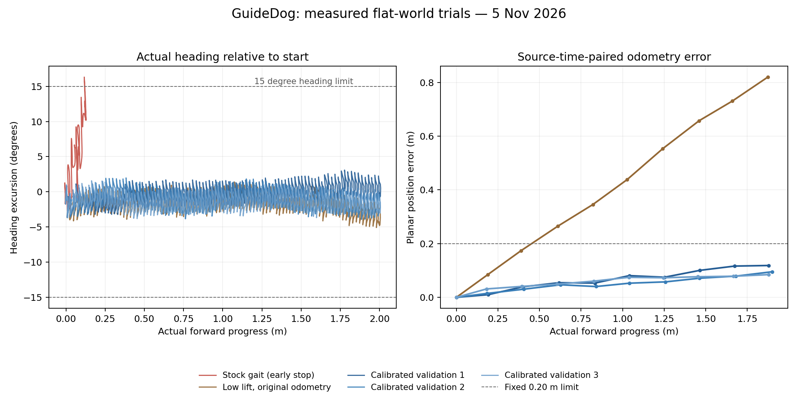

# Прямое движение и одометрия — 5 ноября 2026

**Три независимых проезда на 2 м прошли прежние критерии движения и точности
карты.** Проверенный профиль включён по умолчанию для защищённой плоской
сцены. Связного наблюдаемого пола под весь габарит по-прежнему недостаточно:
планировщик и автоматические повороты остаются закрыты.

Ветка `feat/straight-motion`, родитель измерений `8f022e0` с изменённой рабочей
копией. Симулятор не редактировался и остался на
`55ff151632a0220bf3ae0c0772392615d86da7a8`. [Протокол](straight-motion-protocol.md)
сохраняет скорость 0,05 м/с, пределы 15°/0,30 м, допустимую высоту корпуса,
сроки, независимый STOP и прежние критерии карты. Эталон Gazebo использован
наблюдателем и для отдельной калибровки, а не как вход работающего оценивателя.

## Как нашли две проблемы

Регистратор `--audit-motion` записывает все шесть компонент команд, IMU,
фактическую позу, odom, цели суставов и обратную связь effort-контроллера.
В инструментированном исходном запуске робот продвинулся на 0,117 м и ушёл
по курсу на 15,84°, после чего наблюдатель запросил остановку. Это повторило
ограничение предыдущей серии, где получалось около 0,14 м.

Угловые команды действительно были нулевыми. Поворот наблюдался в физике
Gazebo, IMU и odom; ошибки слежения суставов были небольшими относительно
раскачивания корпуса. Поэтому проверили одну настройку траектории шага:
`gait.swing_height` **0,040 → 0,015 м**. Effort-интерфейс, конфигурация PID,
физика, трение и прочие параметры походки сохранялись. Настройка описывает
траекторию переноса лапы, не гарантированный физический дорожный просвет.

Первый проезд с этой настройкой достиг 2,003 м, с максимальным уходом курса
4,99°. Он ещё **не прошёл карту**: odom насчитал около 1,13 м вместо фактических
2 м, конечная ошибка положения карты достигла 0,862 м. В эталонных коробках
появились ложные свободные клетки. Этот неудачный результат сохранён.

Для этого же ограниченного профиля отдельно определили масштаб кинематической
одометрии. По 2310 парам поз с согласованным временем, без экстраполяции и с
интервалом эталонных поз ≤60 мс, подогнали один общий множитель перемещений
после вычитания начальных поз. При исходном `gait.odom_scaler=0.90` получено
1,59914; до проверок зафиксировали **1,60**. Остаток калибровки: p95 0,083 м,
максимум 0,101 м. Это показатели подгонки на одном заезде, не проверочная
точность. Коэффициент в последующих заездах не подстраивался.

Такая настройка использует предусмотренный CHAMP масштаб одометрии; она не
устраняет все возможные ошибки оценки контактов/скольжения. Параметры шага
описаны в [документации CHAMP](https://github.com/chvmp/champ/blob/master/README.md),
работа effort-контроллера — в [ROS 2 Control Jazzy](https://control.ros.org/jazzy/doc/ros2_controllers/joint_trajectory_controller/doc/userdoc.html).
Причинный вывод здесь ограничен проведёнными опытами, а не всеми походками
или настоящим Go2.

## Независимые проверки после фиксации настроек

Профиль `low_lift_calibrated`: перенос лапы 0,015 м и масштаб odom 1,60.
Остальные настройки сохранены. Каждый заезд начинался в новой симуляции;
не было возобновления сорванной попытки, переноса/поворота робота или новой
подгонки эталона по ходу проезда. Реальные значения обоих параметров прочитаны
через службы ROS и сохранены. Проверка охватывает все полученные позы до
окончания остановки, а не только пятиисекундные контрольные точки.

| Показатель | Заезд 1 | Заезд 2 | Заезд 3, полная серия |
| --- | --- | --- | --- |
| Достигнутое фактическое продвижение | 2,003 м | 2,000 м | 2,003 м |
| Максимальный уход курса, включая остановку | 3,62° | 3,91° | 3,82° |
| Максимальный боковой уход, включая остановку | 0,030 м | 0,021 м | 0,044 м |
| Итоговое продвижение после остановки | 2,002 м | 1,996 м | 2,000 м |
| Наибольшая ошибка положения odom в парных снимках | 0,134 м | 0,111 м | 0,110 м |
| Худшая p95 ошибки границы коробки | 0,186 м | 0,194 м | 0,155 м |
| Наибольшая отдельная ошибка границы | 0,239 м | 0,202 м | 0,202 м |
| Свободных клеток целиком внутри эталонных коробок | 0 | 0 | 0 |
| Парных измерений при движении | 10 из 10 | 10 из 10 | 10 из 10 |
| Контактов робота с препятствиями | 0 | 0 | 0 |

Цель — фактически достичь 2 м до остановки; небольшое движение назад при
успокоении показано отдельно. Допуски остались прежними: odom ≤0,20 м,
p95 границы ≤0,20 м, максимум ≤0,30 м. Ошибки границ относятся к клеткам,
сопоставленным с известными коробками; это не полнота обнаружения любых объектов.
Три заезда подтверждают повторяемость этих сцен, не статистическую надёжность.



Кривые курса прорежены только для изображения; приёмка использует все
полученные позы. Справа показаны промежуточные согласованные снимки карты;
таблица дополнительно включает финальный снимок после остановки.

## Полная серия и оставшийся запрет поиска пути

В третьем заезде дополнительно прошли все четыре статичные сцены. Худшая p95
по известным коробкам: две коробки — 6,73 см, широкий проход — 6,29 см,
узкий — 2,95 см, перекрытый — 5,24 см. Ложных свободных клеток целиком внутри
коробок нет. Контактные датчики каждой коробки положительно проверялись
уникальным пробником вдали от робота.

Итог `planning_readiness=false` при этом **ожидаем и сохранён**: стартовая
ячейка неизвестна, полностью наблюдаемых положений диагностического круга
нет. Зелёные клетки пола остаются разделёнными пробелами. Геометрические
сцены и длинное движение прошли; входной критерий планировщика ещё нет.
Поэтому полная серия завершается кодом 1 с пустым списком проваленных
геометрических/двигательных случаев. Она не объявляет всю навигацию готовой.

Правила классификации клеток, TTL, габарит проверки и запас не менялись.
Неизвестный старт не переносился на ближайший свободный участок. Карта
по-прежнему не публикует команды движения.

## Регрессии и обычный запуск

С новым профилем прошли прежние STOP и короткая карта:

- Итоговый зазор перед коробкой в проверяемом коридоре — **0,815 м**.
- Потеря LiDAR: наблюдаемый ноль через **1,467 с**; потеря команд — **0,360 с**.
- Удерживаемая команда не возобновляла движение после удаления препятствия.
- Короткая карта: фактическое продвижение 0,089 м, смещение окна, сохранение
  препятствия при коротком пропадании, все 6400 клеток неизвестны при длительном,
  восстановление и очистка клетки только новым наблюдением пола. Контактов — ноль.
- Массивы карты — 179 200 байт; p95 обработки в парных снимках длинных заездов
  до 3,19 мс. Это массивы и локальная обработка, не вся память/задержка ROS.
- **93 теста прошли**, один ранее отключённый пропущен. Четыре предупреждения
  относятся к `fork` внутри проверки стиля. Первоначальные ошибки стиля новых
  файлов сохранены в архиве; окончательный набор без падений.

Времена нулевой команды измерены подписчиком по его часам, не как
синхронизированная физическая задержка датчик → привод. Все эти заезды —
серверный EGL-профиль в Ubuntu 24.04 ARM64/ROS Jazzy/Gazebo 8.15, RGB отключён.
GUI и совместная нагрузка камеры не сравнивались в этой серии.

После сборки обычный защищённый запуск уже выбирает проверенные настройки:

```bash
~/guidedog_ws/src/GuideDog-Go2/scripts/run_local_map.sh
```

Для режима без окна добавь `headless:=true`. В другом терминале — прежний
`scripts/drive_guarded.sh`: `i` вперёд, `k`/пробел нейтрально. Скорость
остаётся 0,05 м/с, боковые и угловые команды отклоняются. Отдельная проверка
обычной команды без явного аргумента профиля прочитала 0,015/1,60 в работающих
узлах, не запрашивала движение и завершилась с нулевой командой.

Базовый сенсорный `run_sim.sh` сохраняет `stock` по умолчанию. Для воспроизведения
исходной походки в защищённом запуске укажи `gait_profile:=stock`, в бенчмарке —
`--gait-profile stock`. Автоматический повтор нового проезда:

```bash
~/guidedog_ws/src/GuideDog-Go2/scripts/test_obstacle_demo.sh --motion-only --headless --audit-motion
```

## Данные и следующий шаг

[Исходный заезд](validation/straight-motion-20261105/benchmark-baseline-stock.json),
[калибровочный](validation/straight-motion-20261105/benchmark-calibration-low-lift.json),
[коэффициент](validation/straight-motion-20261105/odom-calibration.json),
проверочные [1](validation/straight-motion-20261105/benchmark-calibrated1.json),
[2](validation/straight-motion-20261105/benchmark-calibrated2.json),
[3](validation/straight-motion-20261105/benchmark-calibrated3-full.json),
[STOP](validation/straight-motion-20261105/benchmark-stop-regression.json),
[короткая карта](validation/straight-motion-20261105/benchmark-map-regression.json),
[тесты](validation/straight-motion-20261105/pytest.xml) и
[метаданные](validation/straight-motion-20261105/measurement-provenance.json) сохранены с кодом.

Полные исходные команды/позы/суставы лежат в `motion-audit.jsonl` каждого
каталога `straight-*` под `~/.ros/guidedog/reports/` в Ubuntu. Краткие метрики,
контрольные суммы и полный сжатый архив всех семи заездов сохранены на Mac в
`output/guidedog-straight-motion-20261105/`. Итоговый коммит и Git bundle
фиксируются в манифесте этой резервной копии; измерения ссылаются на родителя
и изменённую рабочую копию, а не на ещё не существовавший во время заезда коммит.

Следующий отдельный цикл — обосновать подтверждения опоры в слепой зоне и
между наблюдаемыми клетками: источник, срок действия, пространственная
неопределённость, положительный связный коридор и обязательный отказ у края,
дыры или недостатка данных. Простое заполнение неизвестного пола не подходит.

Профиль подтверждён для указанных ровных сцен и скорости. Настройки масштаба
не переносятся автоматически на другие поверхности, походки, бордюры,
лестницы или настоящий Go2 Air. Предварительный просмотр маршрута и затем
защищённые повороты потребуют своих следующих проверок.
