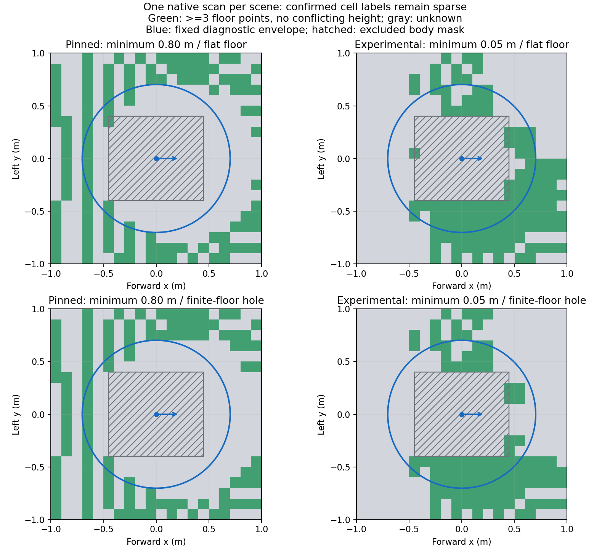

# Проверка опорного пола — 5–6 ноября 2026

**Диагностика добавлена и проверена. Полного наблюдаемого пола под габарит
по-прежнему недостаточно для планировщика.** Установлена одна причина
слепой зоны: ближняя граница датчика в закреплённой симуляции 0,8 м.
Отдельный эксперимент с 0,05 м увеличил количество ближних измерений, но
не устранил маску корпуса и разрывы наблюдаемого пола.

Ветка `feat/support-evidence`, родитель `f0e19e9`. Условия описаны в
[протоколе](support-evidence-protocol.md), запуск и расположение отчётов —
в [инструкции](support-evidence.md). Внешний симулятор сохранил чистый коммит
`55ff151632a0220bf3ae0c0772392615d86da7a8`. Ниже описаны неподвижные опыты;
заезды к яме и управление по новому слою не выполнялись.

## Что изменилось в работающем проекте

При обычном запуске карты автоматически сохраняются `mapping/support_report.json`
и `mapping/support_map.svg`; данные также входят в `/guidedog/local_map_status`.
Отчёт считает метки пола, неизвестные и занятые клетки по всем пересечениям
прежнего диагностического круга радиусом **0,7020797 м**. При потере свежести
он становится недействительным; старый снимок не получает новую метку источника.

Слой наблюдательный. Он не дополняет неизвестный пол плоскостью, не переносит
старт и не разрешает движение. Порог карты три точки пола одного скана,
запрет конфликтующей высоты, сроки хранения, маска корпуса и прежние критерии
связности/движения сохранены. Доля меток пола не доказывает непрерывную
поверхность между точками.

## Почему сравнили ближнюю границу

В [закреплённом URDF](https://github.com/khaledgabr77/unitree_go2_ros2/blob/55ff151632a0220bf3ae0c0772392615d86da7a8/unitree_go2_description/urdf/lidar_4D_lidar.xacro)
дальность начинается с 0,8 м. Для L1 Unitree указывает ближнюю слепую зону
[0,05 м](https://www.unitree.com/mobile/LiDAR/). Поэтому добавлен явный профиль
`l1_near`, меняющий только `lidar/range/min` в временно сгенерированной модели.
Рабочий профиль по умолчанию остаётся `pinned`.

Частота 10 Гц, сетка лучей 600 × 30, углы, шум, крепление, масса, физика и
контроллеры не менялись. Во вторых запусках прочитан параметр
`robot_description` работающего узла: фактические min равны соответственно
0,8 и 0,05 м, max — 30 м. URDF и хеши сохранены. Это проверка одной настройки
симулятора; соответствие всей модели настоящему L1/Go2 Air не установлено.

## Реальные опыты Gazebo

Для каждого профиля выполнены два отдельных запуска с новой симуляцией.
В каждом — 15 разных подходящих сканов ровного пола и 15 сканов после создания
настоящего проёма 0,6 × 0,6 м. Сцена проёма состоит из четырёх видимых и
коллизионных плит с верхом z=0; бесконечная плоскость удалена. Робот остаётся
стоять на левой плите. До опытов подтверждены активные контроллеры, маршрут
через проверенную команду и положительный контактный контроль.

В независимом наблюдателе используются точные TF на метку облака и эталонные
позы Gazebo; все 15+15 сканов повторных запусков получили точный эталон без
временной интерполяции (`pose_bracket_sec=0`). Эталон не поступает в карту/STOP.

| Измерение, повторные запуски | `pinned` 0,8 м | `l1_near` 0,05 м |
| --- | --- | --- |
| Метки пола внутри габарита, снимок ровного пола | 27 / 185 = **14,6%** | 70 / 186 = **37,6%** |
| Неизвестных клеток в этом габарите | 158 | 116 |
| Точки пола в будущем проёме, до удаления пола, на скан | 52–57 | 366–377 |
| Точки пола внутри проёма после удаления, на скан | **0** | **0** |
| Ложные свободные клетки полностью внутри проёма | **0 из 16** | **0 из 16** |
| Метки пола в габарите после потери потока и TTL | **0** | **0** |
| Полный наблюдаемый габарит | **нет** | **нет** |

Количество требуемых клеток зависит от положения круга относительно сетки.
Доли в первой строке относятся к снимкам существующей карты с её накоплением
и TTL; это не средняя по всем сканам и не измерение сплошной площади поверхности.
В первых разведочных запусках доли составляли 13,4% и 34,9%; они сохранены
отдельно в [сводке всех опытов](validation/support-evidence-20261105/summary.json).
Четыре опыта подтверждают повторяемость этих сцен, не статистическую надёжность.

Поле `passed=true` у команды `--floor-audit` означает прохождение её сценариев,
а `planning_ready=false` отдельно сохраняет непройденный критерий планирования.
Во всех четырёх опытах проверенные команды были нулевыми, корпус оставался
на опоре. Потеря данных инвалидировала результат, срок хранения возвращал
метки пола в неизвестное состояние, восстановление возвращало свежие наблюдения.

На рисунке показаны первые сохранённые подходящие сканы повторных запусков,
в координатах `base_footprint`; это отдельная сетка одного скана без TTL,
а не снимки накопленной карты из таблицы. Серое — неизвестно, штриховка —
неизменённая маска корпуса, голубой круг — диагностический габарит.

## Что ещё выявлено

В первых облаках встретились точки точно на нижней границе дальности. В одном
исходном скане 12 из них попали в полосу плоскости вне маски корпуса.
В [Gazebo Sensors 8, `Lidar::ApplyNoise`/`Clamp`](https://github.com/gazebosim/gz-sensors/blob/gz-sensors8/src/Lidar.cc)
конечная дальность ограничивается min/max. Поэтому в повторном независимом
анализе такие точки исключены с допуском 10 мкм к границе. В повторе на ровном
полу исключалось 8–18 точек у `pinned` и 475–541 у `l1_near` на скан.
Исходные XYZ и маски исключения сохранены; первые опыты не пересчитаны.

Это уточнение относится к новому наблюдателю. Рабочая карта и STOP пока
сохраняют прежнюю обработку диапазона. Внедрение проверки насыщения в рабочий
путь требует следующей отдельной регрессии. Прошедший контроль проёма в одной
сцене не отменяет этот недостаток для других сцен.

При профиле 0,05 м в маске корпуса остаётся около 2900 точек на скан рядом
с плоскостью пола. Они записаны как **недоверенные кандидаты**: среди них могут
быть лапы и другие части робота. Маска сохраняет их неизвестными. Простое
удаление этой маски или заполнение пространства между лапами не обосновано.

## Регрессии и сохранность

- Полный набор: **112 тестов прошли, 1 прежний пропущен**, четыре предупреждения
  линтера о `fork` в многопоточном процессе; ошибок тестов нет.
- Прежний STOP на исходном датчике прошёл: конечный эталонный зазор перед
  коробкой 0,824 м, контактов с препятствием 0. Наблюдаемое время до нулевой
  команды при потере LiDAR 1,522 с, команд — 0,417 с. Это измерения повторной
  серии, не универсальные верхние пределы задержек.
- Короткая карта прошла: p95 границы коробки после движения 0,051 м,
  обновление массива p95 2,66 мс, массивы 179200 байт; blackout, expiry и
  очищение свежими точками прошли. Показатель обновления относится к прежнему
  обновлению сетки, не полной стоимости всех новых файлов/SVG.
- Новых длинных двухметровых заездов и заездов с `l1_near` не было. Их нельзя
  считать подтверждёнными регрессиями этого экспериментального профиля.
- Полные облака, журналы шести сцен, исходные версии кода и тестовые результаты
  сохранены вне Git в `output/guidedog-support-evidence-20261105/` на Mac.
  При переносе совпали SHA-256 всех 50 файлов Python; внешний репозиторий чист.
  Небольшие [JSON-отчёты](validation/support-evidence-20261105/summary.json) и
  рисунок включены в эту ветку.

## Следующий шаг

Сначала проверить фильтрацию насыщенных дальностей в рабочем пути и заменить
грубую маску собственной геометрии обоснованным фильтром по модели робота и TF.
Сравнить реальные точки пола и попадания в корпус/лапы, включая отсутствующую TF.
После этого отдельно обосновать поддержку между редкими лучами; отсутствующие
данные сохранять неизвестными, проверять проёмы/края и пропадание потока.
Лишь затем повторить прежнюю серию связности под габарит и цели 3 м.
Планировщик и автоматические повороты остаются следующим, пока закрытым этапом.
